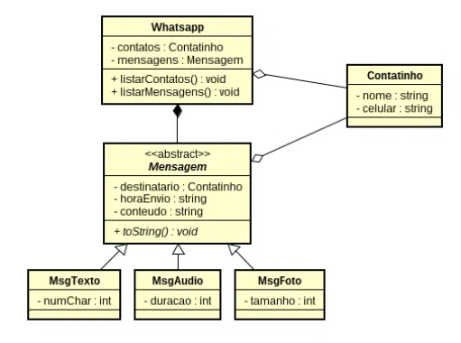
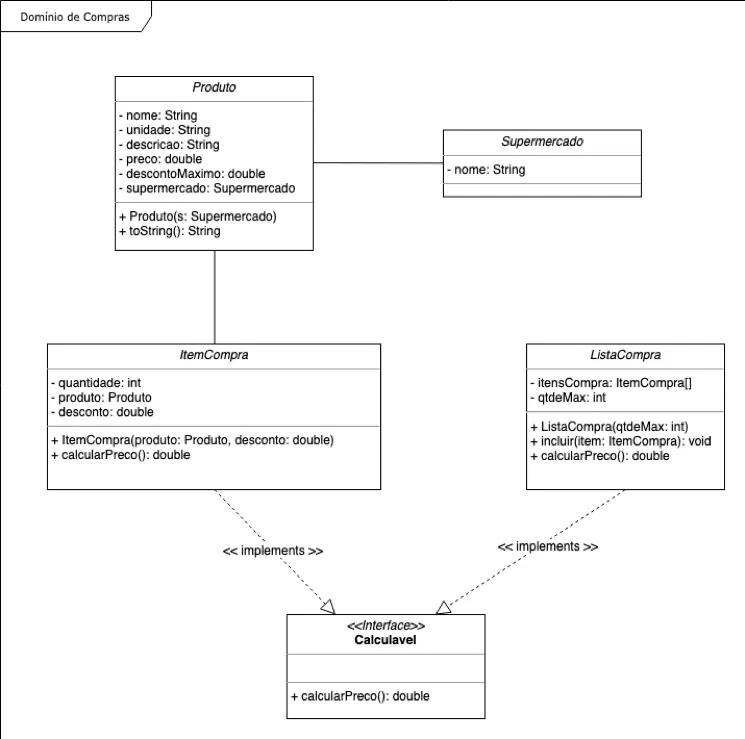

# LP2 - Exercicios de Orientacao a Objetos

## Exercicio 1 - Whatsapp

Simula um aplicativo de mensagens. O Whatsapp guarda uma lista de contatos e uma lista de mensagens enviadas. Cada mensagem tem um destinatário, a hora de envio e um conteúdo, e pode ser de três tipos:

- Texto: guarda a quantidade de caracteres da mensagem.
- Áudio: guarda a duracao do áudio em segundos.
- Foto: guarda o tamanho da imagem em KB.

Ao executar, o programa lista todos os contatos e todas as mensagens enviadas.

## Exercicio 2 - Dominio de Compras

Simula as compras em um supermercado. Cada produto pertence a um supermercado e possui preço e um desconto máximo permitido. O cliente monta itens de compra, cada um com um produto, a quantidade e um desconto que não pode passar do máximo do produto.

Os itens são adicionados a uma lista de compras, que tem um limite de itens. O programa calcula o preço de cada item separadamente e o preço total da lista.

## Como executar

Abra a pasta do exercicio desejado (`lp2-exercicio1` ou `lp2-exercicio2`) na IDE e execute a classe `Main`.
